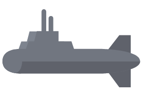
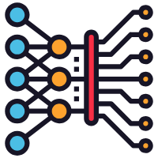

One of my hobbies is reviewing high-quality **EECS open courses** and re-organizing the materials for the most important ones in my own words. I find that distilling the key concepts and structuring them in a learner-friendly way not only deepens my own understanding, but also helps others benefit from these world-class resources.

**If you are looking for excellent deep learning CS courses, I recommend checking out this curated [course list](https://lzz19980125.github.io/posts/2025-8-8-cs%20courses%20list) that I have compiled.**

Below are my reorganized materials and notes for several significant courses I have studied.

------

##   Autonomous Marine Intelligent Systems

***Norwegian University of Science and Technology — TTK4190: Guidance, Navigation and Control of Marine Craft, Aircraft and Drones***

This course covers guidance, navigation, and control principles for marine craft. In this course, I focus particularly on the derivation of the kinematic and kinetic equations for underwater unmanned systems

$$
M\dot{\nu}+C(\nu )\nu +D(\nu )\nu +g(\eta )=\tau 
$$

which form the foundation for precise attitude control, path planning, and coordinated formation.

- [Ch1: Introduction to Part I](https://lzz19980125.github.io/posts/2025-7-20-Introduction%20to%20Underwater%20Glider)
- [Ch2: Kinematics](https://lzz19980125.github.io/posts/2025-7-28-Kinematic%20Analysis%20of%20Underwater%20Gliders)
- [Ch3: Rigid-Body Kinetics](https://lzz19980125.github.io/posts/2025-8-2-Kinetics%20Analysis%20of%20Underwater%20Gliders)	

------

##  Deep Learning

***MIT 6.S898: Deep Learning***

A cutting-edge deep learning course covering architectures, optimization techniques, and applications. My notes focus on intuitive explanations of core concepts like attention mechanisms, representation learning, and large-scale model training.

- [Computation Graphs & BackProp](https://zhuanlan.zhihu.com/p/662749544)

------

## Reinforcement Learning

***UCB CS 285: Deep Reinforcement Learning***

An in-depth exploration of policy optimization, value-based methods, and model-based RL. I mainly reorganized the sections on Policy Gradient, Actor-Critic Algorithms, and Value Function Methods.

- [lecture 4: Intro to RL](https://zhuanlan.zhihu.com/p/659134755)
- [lecture 5: Policy Gradient](https://zhuanlan.zhihu.com/p/659672341)
- [lecture 6: Actor-Critic Algorithm](https://zhuanlan.zhihu.com/p/659793509)
- [lecture 7: Value Function Methods](https://zhuanlan.zhihu.com/p/661276555)

------

## Edge Computing

***MIT 6.S965: TinyML and Efficient Deep Learning Computing***

This course focuses on deploying deep learning models in resource-constrained environments. My summary includes hands-on notes on the principles of common convolution operators and neural network efficiency metrics, and will be extended in the future to cover quantization, pruning, NAS, and distillation.

- [Lecture 2: Basics of Deep Learning](https://zhuanlan.zhihu.com/p/7388813431)

------

## Distributed Systems

***MIT 6.824: Distributed Systems***
 
A legendary course on distributed computing principles, from consensus protocols (like Raft) to fault tolerance. I emphasize diagrams and execution traces to make complex concepts approachable.

- [Lecture 1: Mapreduce](https://github.com/lzz19980125/MIT_6.824/blob/main/lecture%20notes/Lecture1%20Mapreduce/Lecture_1_introduction%20and%20Mapreduce.md)
- [Lecture 2: Go,RPC,Threads](https://github.com/lzz19980125/MIT_6.824/blob/main/lecture%20notes/Lecture%202%20Go%2CRPC%2CThreads/Lecture_1_introduction%20and%20Mapreduce.md)
- [A tour of Go](https://github.com/lzz19980125/MIT_6.824/blob/main/lecture%20notes/A%20tour%20of%20Go/A%20tour%20of%20GO.md)
- [Lab 1: Re-implement MapReduce model described in OSDI' 04](https://github.com/lzz19980125/MIT_6.824)

------

## Computer Science Fundamentals

- ***UCB CS61A: Structure and Interpretation of Computer Programs***

  Focused on computational thinking and functional programming fundamentals.

  [Course materials](https://github.com/lzz19980125/UC-Berkeley_CS61A)
  
- ***UCB CS61B: Data Structures and Algorithms***

  A comprehensive treatment of core data structures, algorithm analysis, and implementation patterns.

  [Course materials](https://github.com/lzz19980125/UC_Berkeley_CS61B)

------

## Research Contributions

Beyond course reviews, I have also created several **awesome reading lists** focused on *multivariate time series research*. These lists have collectively received **500+ GitHub stars**, reflecting the value they bring to the research community.

- [awesome-time-series-segmentation-papers](https://github.com/lzz19980125/awesome-time-series-segmentation-papers)
- [awesome-multivariate-time-series-anomaly-detection-algorithms](https://github.com/lzz19980125/awesome-multivariate-time-series-anomaly-detection-algorithms)
- [awesome-multivariate-time-series-clustering-algorithms](https://github.com/lzz19980125/awesome-multivariate-time-series-clustering-algorithms)

------

If you are passionate about self-learning in EECS, I hope my reorganized course materials and curated resources can serve as useful study companions.

