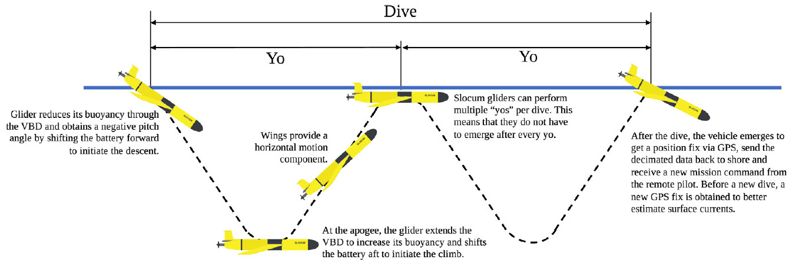
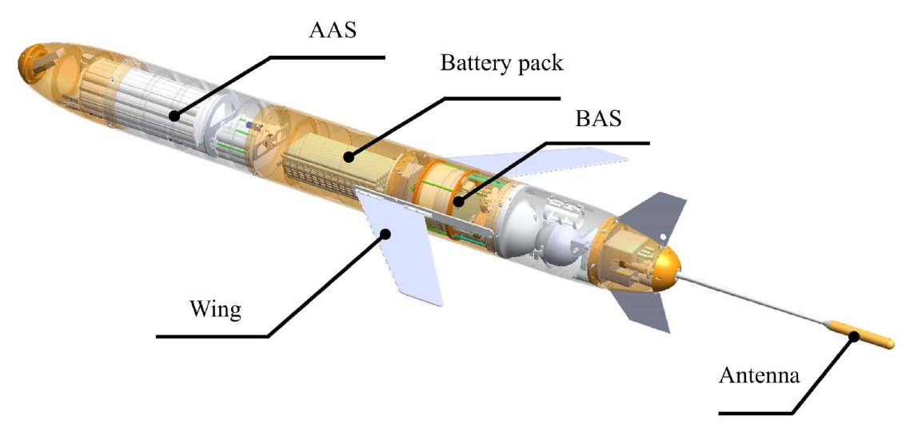
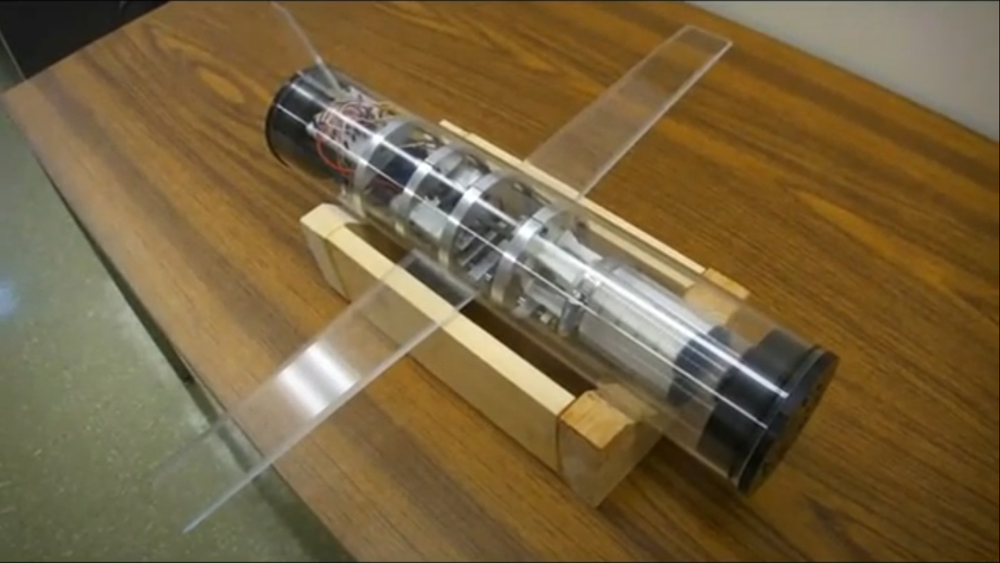
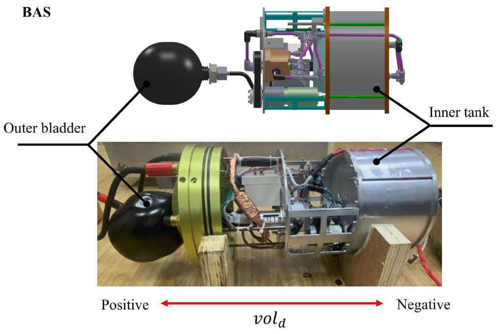
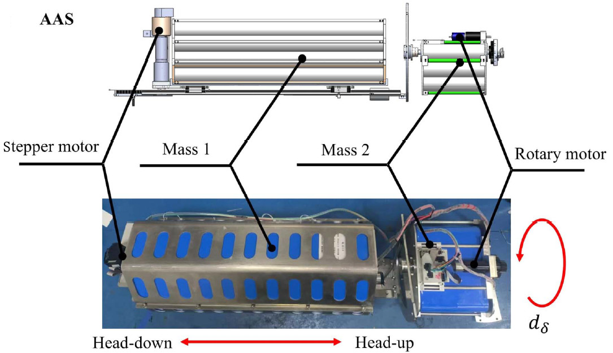
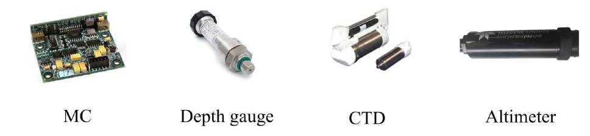

This article presents an introduction to the fundamental principles and hardware architecture of underwater gliders.

## **Archimedes' Principle**

As early as middle school, we learned to explain the origin of buoyancy using **Archimedes' principle**:

> **An object submerged in a fluid (such as seawater) experiences an upward buoyant force equal to the weight of the fluid it displaces.**

The corresponding equation is:
 **Fbuoy = ρfluid × g × Vdisp**

Where:

- ρfluid is the density of seawater,
- *g* is the gravitational acceleration,
- Vdisp is the volume of seawater displaced by the object.

The vertical motion of an object in water depends on the relationship between **buoyancy** and **gravity**:

- When **buoyancy > weight**, the object rises.
- When **buoyancy < weight**, the object sinks.
- When **buoyancy = weight**, the object remains suspended.

In physics, the term *static buoyancy* typically refers to the buoyant force *Fbuoy* itself. However, in engineering applications—especially when discussing underwater gliders—we focus more on a derived concept: **net buoyancy**. The **net buoyant force** (*Fnet*) is defined as:

**Fnet = Fbuoy - Gobject**

Net buoyancy represents the resultant vertical force that determines whether the underwater vehicle ascends, descends, or hovers. Specifically:

- **Fnet > 0**: The net buoyant force is positive → the vehicle rises.
- **Fnet < 0**: The net buoyant force is negative → the vehicle sinks.
- **Fnet = 0**: The net buoyant force is zero → the vehicle hovers (or maintains a constant vertical velocity).

## Working Principle and Mechanism of Underwater Gliders

Underwater gliders control their vertical movement—descending and ascending—by adjusting their **net buoyancy**. Equipped with fixed wings, they convert vertical motion into horizontal glide using **hydrodynamic lift**. This method is highly energy-efficient: gliders **do not rely on continuously spinning propellers**, and consume only minimal energy when adjusting buoyancy or attitude. As a result, they can operate autonomously in the ocean for several months or even over a year, covering distances of thousands of kilometers.

 

To adjust net buoyancy, there are two main approaches:

- **Changing the displaced fluid volume** while keeping the mass constant.
- **Changing the mass** while keeping the displaced fluid volume constant.

The former typically involves **oil bladder systems** to modulate buoyancy, while the latter involves **taking in or expelling seawater** to vary the overall mass.

------

### 1. Variable Volume / Variable Displacement

This is the most common approach used in long-endurance underwater gliders such as **Slocum**, **Seaglider**, **Spray**, and **Petrel-L**.

- **Operating Principle**:
  - The glider's **total mass (m)** remains approximately constant.
  - It contains a **rigid high-pressure internal oil reservoir** and a **flexible external bladder**.
  - A **low-power hydraulic pump** transfers oil from the internal reservoir into the external bladder, increasing the **overall volume (V)** of the vehicle.
  - According to Archimedes' principle (Fbuoy = ρseawater × g × Vdisp), an increase in displaced volume leads to increased buoyant force. When buoyancy exceeds gravity, the glider rises.
  - Conversely, by pumping oil back into the internal reservoir, the overall volume decreases, reducing buoyancy. When buoyancy is less than gravity, the glider sinks.
- **Advantages**:
  - **Low energy consumption**: Only a small amount of energy is needed to move oil, which is significantly more efficient than directly displacing water—especially under high-pressure deep-sea conditions.
  - **High precision**: The volume of oil transferred can be finely controlled.
  - **High reliability**: The hydraulic system is a **closed loop**, making it resistant to seawater corrosion and biofouling.

------

### 2. Variable Mass / Variable Ballast

This approach is more commonly found in other types of underwater vehicles, such as certain AUVs, underwater robots, or submarines.

- **Operating Principle**:
  - The glider's **overall volume (V)** remains approximately constant.
  - A **water pump system** draws seawater into an internal ballast tank or expels it back into the ocean.
  - When seawater is drawn in, the glider’s **total mass (m)** increases, resulting in greater gravitational force (G = m × g). When gravity exceeds buoyancy, the glider sinks.
  - When seawater is expelled, the total mass decreases, reducing gravity. When gravity is less than buoyancy, the glider rises.
- **Advantages**:
  - Allows for **large changes in net buoyancy**, potentially enabling **faster vertical motion**.
  - The working medium (seawater) is **abundant and readily available**.
- **Disadvantages**:
  - **Higher energy consumption**: Especially at great depths, high-pressure pumps are required to expel seawater, leading to significant energy usage.
  - **Vulnerability to corrosion and clogging**: Seawater is corrosive, and marine microorganisms or particles may clog pipes or pumps, affecting system reliability.

##  Key Systems and Components of an Underwater Glider

An underwater glider is a marvel of efficiency, integrating several key systems that work in concert to enable long-duration, autonomous missions. Understanding these core components reveals how these vehicles navigate and collect data for months at a time.

### Buoyancy Adjustment System (BAS)

The BAS is effectively the "engine" of the glider, responsible for controlling its ascent and descent. The most common and energy-efficient designs operate on a **variable volume** principle.

- **Principle**: The system adjusts the glider's overall volume to alter its buoyancy. It typically consists of a rigid internal oil reservoir and a flexible external bladder. A low-power hydraulic pump transfers a precise amount of oil into the external bladder, increasing the glider's total volume. This displacement increases the buoyant force, causing the glider to rise. To descend, oil is pumped back into the internal reservoir, decreasing the volume and allowing gravity to pull the glider down.
- **Advanced Designs**: Some advanced gliders may employ sophisticated **dual-circuit** systems. A highly efficient, low-pressure pump is used for operations at shallower depths, while a more powerful, high-pressure pump is engaged to ensure reliable ascent from the extreme pressures of the deep ocean. This optimizes energy consumption across the full operational range.

 

### Attitude Adjustment System (AAS)

The AAS is responsible for controlling the glider's orientation—specifically its **pitch** (nose up/down) and **roll** (rotation around its long axis). To maintain a streamlined profile and minimize drag, gliders achieve this by shifting internal masses rather than using external control surfaces like rudders.

- **Pitch Control**: To control pitch, a significant internal mass—often the heavy battery pack—is moved forward or backward along a linear track. Moving the weight forward shifts the vehicle's center of gravity, causing the nose to pitch down for a descent. Moving it backward causes the nose to pitch up, setting the optimal angle for an ascent.
- **Roll Control**: To steer, the glider must roll. This is accomplished by rotating a separate internal mass around the glider's central axis using a rotary motor. This banking motion, combined with the hydrodynamic forces on the wings, causes the glider to turn. This mechanism allows for heading adjustments and the execution of complex spiral profiles for detailed, localized sampling.

 

### Navigation and State Sensors

A suite of onboard sensors allows the glider to determine its position, orientation, and state, which is essential for autonomous navigation and control.

- **Magnetic Compass (MC)**: Measures the glider's heading (yaw) relative to Earth's magnetic field. This is the primary sensor for maintaining a designated course over long distances.
- **Depth Gauge (Pressure Sensor)**: Continuously measures the ambient water pressure, which is precisely converted into the glider's current depth. This data is critical for executing the programmed dive-and-ascent profile, ensuring the glider operates within its safe depth limits.
- **Altimeter**: A forward- or downward-facing acoustic sensor (sonar) that measures the distance to the seafloor. Its primary function is **collision avoidance**, preventing the glider from impacting the seabed, especially in coastal areas or regions with complex, unmapped bathymetry.

 

### Scientific Payload: CTD Sensor

While gliders can be fitted with various scientific sensors (e.g., for oxygen, chlorophyll, or acoustics), the most fundamental payload for physical oceanography is the CTD.

- **Function**: The CTD measures three core properties of seawater:
  - **C**onductivity: From which water **salinity** is calculated.
  - **T**emperature: Measured with high accuracy.
  - **D**epth: Confirmed by an integrated high-precision pressure sensor.
- **Importance**: CTD data allows scientists to map the structure of the ocean, identifying different water masses, currents, eddies, and critical features like the **thermocline** (a layer of rapid temperature change). This information is foundational to understanding ocean dynamics, climate patterns, and marine ecosystems.

### Load Dump System

This is a critical **fail-safe mechanism** designed to ensure the vehicle can be recovered in the event of a mission-ending emergency.

- **Principle**: The system consists of a disposable ballast weight attached to the glider's exterior by an electromechanical release mechanism.
- **Operation**: If the glider's control system detects a catastrophic failure—such as a leak, total power loss, or an inability to achieve positive buoyancy—it will trigger the release. By jettisoning the weight, the glider instantly becomes strongly buoyant and ascends to the surface, where it can be located via satellite and recovered.
- **Importance**: This system is a last resort for asset protection. It drastically increases the probability of recovering the expensive instrument and its invaluable data should a critical malfunction occur during a multi-month deployment.

## References
[1] L. Lei, Y. Zhou, and J. Zhang, “From Extended Environment Perception Toward Real-Time Dynamic Modeling for Long-Range Underwater Robot,” IEEE Transactions on Robotics, vol. 41, pp. 3423–3441, 2025, doi: 10.1109/TRO.2025.3567531.
[2] T. I. Fossen, Handbook of Marine Craft Hydrodynamics and Motion Control. Hoboken, NJ, USA: John Wiley & Sons, 2011.
