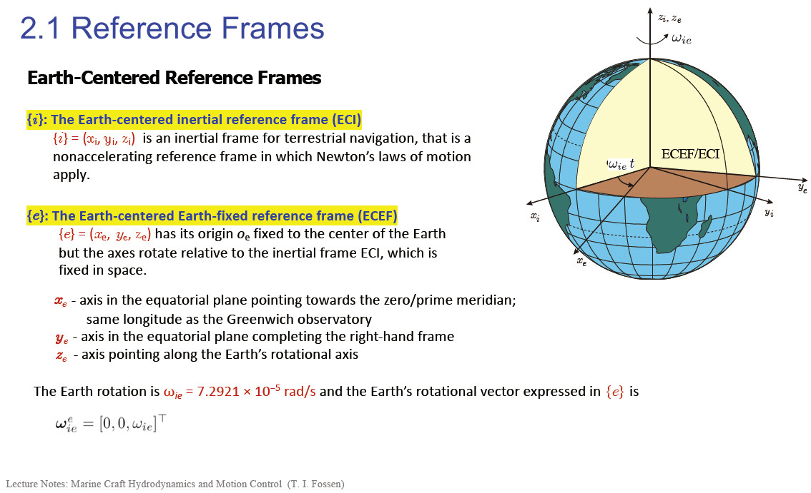
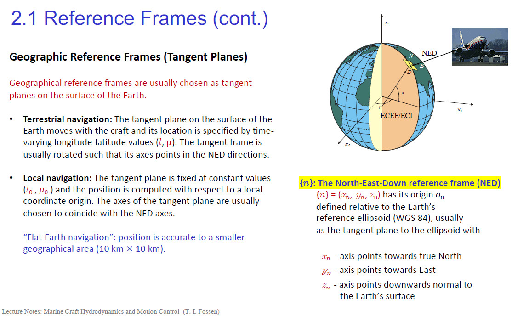

## Introduction

Underwater gliders are a class of autonomous underwater vehicles (AUVs) that achieve propulsion through small changes in buoyancy and use wings to convert this vertical motion into horizontal travel. Their high energy efficiency allows for long-duration missions spanning months and covering thousands of kilometers. To navigate, control, and execute these missions, a precise understanding of their motion is paramount. This is the realm of **kinematics**.

This post will delve into the fundamental kinematic analysis of underwater gliders. We will build, step-by-step, the mathematical framework that connects the glider's internal, body-relative movements to its position and orientation in the global frame. Our goal is to derive the complete 6-DOF (Degrees-of-Freedom) kinematic equations, which form the bedrock of any glider's guidance, navigation, and control (GNC) system.

## 1. What is Kinematics?

The study of motion, or **dynamics**, can be conceptually divided into two distinct parts. This distinction is crucial for structuring the problem of vehicle modeling.

*   **Kinematics**: This is the study of the *geometry of motion*. It describes the position, velocity, and acceleration of a body without considering the forces that cause this motion. Kinematics answers the question: "Given the vehicle's current velocity, where will it be and how will it be oriented in the next instant?"
*   **Kinetics**: This is the analysis of the *forces* that cause motion. It relates the forces and moments acting on a body (e.g., buoyancy, lift, drag, thrust) to its resulting accelerations, governed by Newton's second law. Kinetics answers the question: "Given the forces acting on the vehicle, how will its velocity change?"

In essence: $$dynamics = kinematics + kinetics.$$ This article focuses exclusively on **kinematics**.

## 2. The Language of Motion: Frames, Points, and Angles

To describe motion unambiguously, we must first define our reference frames and key parameters.

### 2.1 Coordinate Frames

We use several coordinate frames, each serving a specific purpose, to describe the glider's state.

*   **Earth-Centered Inertial (ECI) Frame { $$i$$ }**: This is a non-accelerating frame with its origin at the Earth's center. Its axes are fixed relative to the distant stars. In this frame, Newton's laws of motion apply directly. It is the ultimate reference for terrestrial navigation but is cumbersome for practical vehicle control.

*   **Earth-Centered Earth-Fixed (ECEF) Frame $$\{e\}$$**: This frame also has its origin at the Earth's center, but its axes are fixed to the Earth and rotate with it. The $$x_e$$-axis points through the prime meridian, the $$z_e$$-axis points through the North Pole, and the $$y_e$$-axis completes the right-handed system. GPS provides position data in this frame.

    

*   **North-East-Down (NED) Frame $$\{n\}$$**: This is a local navigation frame, tangent to the Earth's surface at the vehicle's location (or a nearby origin). Its axes are aligned with the geodetic directions: $$x_n$$ points to True North, $$y_n$$ points to True East, and $$z_n$$ points down, normal to the Earth's surface. This is the most intuitive frame for vehicle guidance, as commands like "head east for 1 kilometer" are naturally expressed here.

   

*   **BODY Frame `{b}`**: This frame is fixed to the glider itself, with its origin $$(O_b)$$ typically at the vehicle's geometric center. The axes are defined as:

    *   $$x_b$$ (Surge): Points from aft to fore along the glider's longitudinal axis.

    *   $$y_b$$(Sway): Points out the starboard (right) side.

    *   $$z_b$$ (Heave): Points downwards, completing the right-handed system.

        All forces (hydrodynamic), moments, and sensor measurements (from an IMU) are most naturally expressed in this frame.

The central challenge of kinematics is to relate the BODY frame {b} to the NED frame {n}.

### 2.2 Important Angles of Motion

The interaction between the glider and the surrounding water is defined by key angles:

*   **Angle of Attack (α)**: The angle between the vehicle's velocity vector relative to the water and the BODY $$x_b-y_b$$ plane. It is the primary driver for generating lift on the wings.
*   **Sideslip Angle (β)**: The angle between the vehicle's velocity vector relative to the water and the BODY  $$x_b-z_b$$ plane. Ideally, this is kept near zero for efficient flight.

### 2.3 Key Reference Points

For a marine vehicle, four "centers" are of particular interest:

*   **CO (Coordinate Origin)**: The origin of the BODY frame `{b}`.
*   **CG (Center of Gravity)**: The point where the total gravitational force acts. For a glider, the relative position between CG and CB is fundamental to creating pitching moments.
*   **CB (Center of Buoyancy)**: The centroid of the displaced water volume, where the buoyant force acts. Gliders actively change their buoyancy to control depth.
*   **CF (Center of Flotation)**: The centroid of the waterplane area. This is more relevant for surface vessels' roll/pitch stability.

## 3. A Unified Notation: The SNAME Framework

To formalize our analysis, we adopt the standard notation proposed by The Society of Naval Architects and Marine Engineers (SNAME, 1950). This defines the 6-DOF state and velocity vectors.

| DOF  | Motion                     | Forces & Moments (BODY) | Linear & Angular Velocities (BODY)  $$ν$$ | Positions & Euler Angles (NED)  $$η$$ |
| :--- | :------------------------- | :---------------------- | :---------------------------------------- | :------------------------------------ |
| 1    | Surge (in $$x_b$$ dir.)    | $$X$$                   | $$u$$                                     | $$x^n$$                               |
| 2    | Sway (in $$y_b$$ dir.)     | $$Y$$                   | $$v$$                                     | $$y^n$$                               |
| 3    | Heave (in $$z_b$$ dir.)    | $$Z$$                   | $$w$$                                     | $$z^n$$                               |
| 4    | Roll (about $$x_b$$ axis)  | $$K$$                   | $$p$$                                     | $$φ$$ (phi)                           |
| 5    | Pitch (about $$y_b$$ axis) | $$M$$                   | $$q$$                                     | $$θ$$ (theta)                         |
| 6    | Yaw (about $$z_b$$ axis)   | $$N$$                   | $$r$$                                     | $$ψ$$ (psi)                           |

We can express these as two primary vectors:

1.  **Generalized velocity vector in BODY `{b}`**:
    $$ \nu = [u, v, w, p, q, r]^T $$
2.  **Generalized position and attitude vector in NED `{n}`**:
    $$ \eta = [x^n, y^n, z^n, \phi, \theta, \psi]^T $$

The entire purpose of our kinematic study is to find the mathematical operator $$ J(\eta) $$ that links these two vectors via the differential equation:

$$ \dot{\eta} = J(\eta)\nu $$

## 4. The Bridge Between Worlds: Transforming from BODY to NED

Here we construct the transformation matrix $$ J(\eta) $$ by analyzing the linear and angular relationships between the BODY and NED frames.

### 4.1 The Tool for Rotation: Special Orthogonal Matrices (SO(3))

The orientation of the BODY frame relative to the NED frame is a pure rotation. This transformation must satisfy two crucial properties:

1.  **It must be Orthogonal**: The transformation changes perspective, not the glider's physical shape. It preserves the length of vectors and the angles between them. Mathematically, this means the matrix $$ R $$ satisfies $$ R^T R = I $$, where $$ I $$ is the identity matrix.
2.  **It must be "Special"**: Both the BODY and NED frames are right-handed systems. A physical rotation cannot turn a right-handed system into a left-handed one (a reflection or "mirror image"). This property of preserving the "handedness" or orientation of space is captured by the condition that the determinant of the matrix is +1, i.e., $$ det(R) = 1 $$.

The set of all 3x3 matrices that satisfy these two conditions forms the **Special Orthogonal Group SO(3)**. Any rotation matrix $$ R $$ used to transform between `{b}` and `{n}` must be an element of $$ SO(3) $$.

### 4.2 A Computational Shortcut: The Skew-Symmetric Matrix

In rotational mechanics, the vector cross-product appears frequently. A powerful computational tool is the skew-symmetric matrix $$ S(\lambda) $$, which converts a cross-product operation into a matrix-vector multiplication:

$$ \lambda \times \mathbf{a} := S(\lambda)\mathbf{a} $$

Where for a vector $$ \lambda = [\lambda_1, \lambda_2, \lambda_3]^T $$, the matrix $$ S(\lambda) $$ is:

$$ S(\lambda) = \begin{bmatrix} 0 & -\lambda_3 & \lambda_2 \\ \lambda_3 & 0 & -\lambda_1 \\ -\lambda_2 & \lambda_1 & 0 \end{bmatrix} $$

This doesn't represent a physical transformation but is a vital algebraic tool that simplifies the derivation and computation of kinematic equations, especially in Rodrigues' Rotation Formula.

### 4.3 Parameterizing Rotation: Euler Angles

While $$ SO(3) $$ matrices are the correct mathematical objects, they are not very intuitive. We often parameterize them using three **Euler angles**: yaw, pitch, and roll $$ (\psi, \theta, \phi) $$. For marine and aerospace vehicles, the standard convention is a **ZYX sequence**:

1.  **Yaw (`ψ`)**: A rotation around the $$ z_n $$ axis.
2.  **Pitch (`θ`)**: A rotation around the new (once-rotated) $$ y $$ axis.
3.  **Roll (`φ`)**: A rotation around the final (twice-rotated) $$ x_b $$ axis.

Each of these is a simple rotation, and the total rotation matrix from BODY to NED, denoted $$ R_{nb}(\Theta_{nb}) $$, is obtained by multiplying their individual rotation matrices. Note $$ \Theta_{nb} = [\phi, \theta, \psi]^T $$.

$$ R_{nb}(\Theta_{nb}) = R_{z,\psi} R_{y,\theta} R_{x,\phi} $$

The full matrix is:

$$ R(\Theta_{nb}) = \begin{bmatrix} c\psi c\theta & -s\psi c\phi + c\psi s\theta s\phi & s\psi s\phi + c\psi c\phi s\theta \\ s\psi c\theta & c\psi c\phi + s\phi s\theta s\psi & -c\psi s\phi + s\theta s\psi c\phi \\ -s\theta & c\theta s\phi & c\theta c\phi \end{bmatrix} $$

(where `c` is cos and `s` is sin).

### 4.4 Deriving the Kinematic Equations

With the rotation matrix defined, we can now build our bridge.

#### **Linear Velocity Transformation (Position)**

The velocity of the glider in the BODY frame is $$ \mathbf{v}_b = [u, v, w]^T $$. To find the rate of change of its position in the NED frame, $$ \dot{\mathbf{p}}_n = [\dot{x}^n, \dot{y}^n, \dot{z}^n]^T $$, we simply rotate the BODY velocity vector into the NED frame:

$$ \dot{\mathbf{p}}_n = R_{nb}(\Theta_{nb}) \mathbf{v}_b $$

This is the first half of our kinematic model.

#### **Angular Velocity Transformation (Attitude)**

This part is more subtle. The time derivatives of the Euler angles, $$ \dot{\Theta}_{nb} = [\dot{\phi}, \dot{\theta}, \dot{\psi}]^T $$, are not a simple rotation of the BODY frame angular velocities, $$ \mathbf{\omega}_b = [p, q, r]^T $$. This is because the axes for yaw, pitch, and roll rates are not orthogonal and are themselves moving. The relationship is linear but described by a different transformation matrix, $$ T(\Theta_{nb}) $$:

$$ \dot{\Theta}_{nb} = T(\Theta_{nb}) \mathbf{\omega}_b $$

The matrix $$ T(\Theta_{nb}) $$ is:

$$ T(\Theta_{nb}) = \begin{bmatrix} 1 & s\phi t\theta & c\phi t\theta \\ 0 & c\phi & -s\phi \\ 0 & s\phi/c\theta & c\phi/c\theta \end{bmatrix} $$
(where `t` is tan).

A critical flaw of Euler angles is evident here: when the pitch angle $$ \theta = \pm 90^\circ $$, $$ cos(\theta) = 0 $$, and the matrix $$ T $$ becomes singular. This condition is known as **Gimbal Lock**, where roll and yaw become indistinguishable.

#### **The Complete 6-DOF Kinematic Model**

We can now assemble the complete model by combining the linear and angular equations into the compact matrix form we sought:

$$ \dot{\eta} = \begin{bmatrix} \dot{\mathbf{p}}_n \\ \dot{\Theta}_{nb} \end{bmatrix} = \begin{bmatrix} R_{nb}(\Theta_{nb}) & \mathbf{0}_{3\times3} \\ \mathbf{0}_{3\times3} & T(\Theta_{nb}) \end{bmatrix} \begin{bmatrix} \mathbf{v}_b \\ \mathbf{\omega}_b \end{bmatrix} = J(\eta)\nu $$

This equation is the final result of our kinematic analysis. It provides the exact differential relationship between the easily measured BODY frame velocities $$ \nu $$ and the globally relevant NED frame states $$ \eta $$. By numerically integrating this equation over time, a glider's navigation system can continuously track its position and attitude in the world.

## Conclusion

We have successfully constructed the 6-DOF kinematic model for an underwater glider. This journey took us through the essential concepts of reference frames, the rigorous mathematics of $$ SO(3) $$ rotation matrices, and the practical (though flawed) parameterization using Euler angles. The final equation, $$ \dot{\eta} = J(\eta)\nu $$, represents the fundamental "bridge" connecting the glider's internal world to the external one.

While we used Euler angles for their intuitive appeal, it is worth noting that modern GNC systems often use **Quaternions** to represent attitude. Quaternions provide a singularity-free and computationally efficient alternative, a topic for a future discussion. With this kinematic model in hand, the next step is to explore the world of kinetics—the hydrodynamic and buoyancy forces that generate the velocities $$ \nu $$ in the first place.

