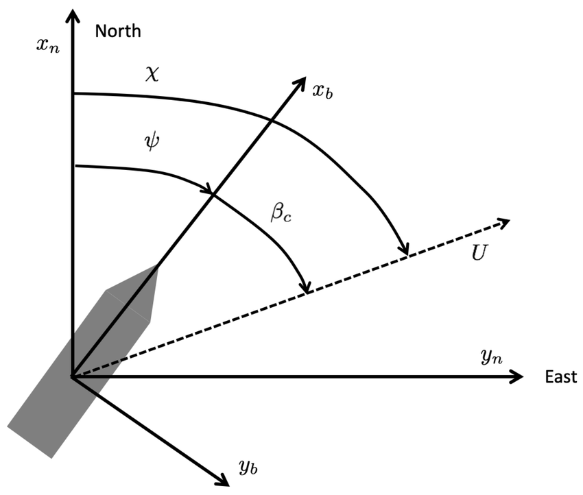
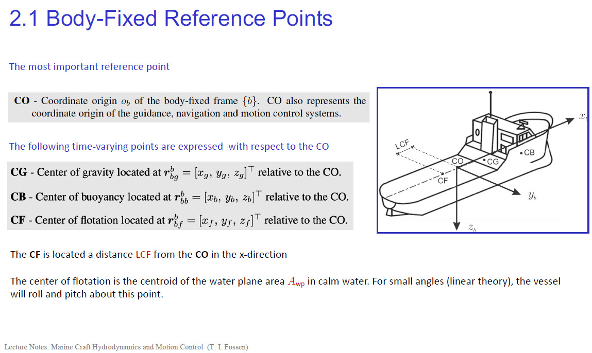

## Introduction

Underwater gliders are a class of autonomous underwater vehicles (AUVs) that achieve propulsion through small changes in buoyancy and use wings to convert this vertical motion into horizontal travel. Their high energy efficiency allows for long-duration missions spanning months and covering thousands of kilometers. To navigate, control, and execute these missions, a precise understanding of their motion is paramount. This is the realm of **kinematics**.

This post will delve into the fundamental kinematic analysis of underwater gliders. We will build, step-by-step, the mathematical framework that connects the glider's internal, body-relative movements to its position and orientation in the global frame. Our goal is to derive the complete 6-DOF (Degrees-of-Freedom) kinematic equations, which form the bedrock of any glider's guidance, navigation, and control (GNC) system.

## 1. What is Kinematics?

The study of motion, or **dynamics**, can be conceptually divided into two distinct parts. This distinction is crucial for structuring the problem of vehicle modeling.

*   **Kinematics**: This is the study of the *geometry of motion*. It describes the position, velocity, and acceleration of a body without considering the forces that cause this motion. Kinematics answers the question: "Given the vehicle's current velocity, where will it be and how will it be oriented in the next instant?"
*   **Kinetics**: This is the analysis of the *forces* that cause motion. It relates the forces and moments acting on a body (e.g., buoyancy, lift, drag, thrust) to its resulting accelerations, governed by Newton's second law. Kinetics answers the question: "Given the forces acting on the vehicle, how will its velocity change?"

In essence: $$dynamics = kinematics + kinetics.$$ This article focuses exclusively on **kinematics**.

## 2. The Language of Motion: Frames, Points, and Angles

To describe motion unambiguously, we must first define our reference frames and key parameters.

### 2.1 Coordinate Frames

We use several coordinate frames, each serving a specific purpose, to describe the glider's state.

*   **Earth-Centered Inertial (ECI) Frame `{i}`**: This is a non-accelerating frame with its origin at the Earth's center. Its axes are fixed relative to the distant stars. In this frame, Newton's laws of motion apply directly. It is the ultimate reference for terrestrial navigation but is cumbersome for practical vehicle control.

*   **Earth-Centered Earth-Fixed (ECEF) Frame `{e}`**: This frame also has its origin at the Earth's center, but its axes are fixed to the Earth and rotate with it. The $$x_e$$-axis points through the prime meridian, the $$z_e$$-axis points through the North Pole, and the $$y_e$$-axis completes the right-handed system. GPS provides position data in this frame.

    

*   **North-East-Down (NED) Frame `{n}`**: This is a local navigation frame, tangent to the Earth's surface at the vehicle's location (or a nearby origin). Its axes are aligned with the geodetic directions: $$x_n$$ points to True North, $$y_n$$ points to True East, and $$z_n$$ points down, normal to the Earth's surface. This is the most intuitive frame for vehicle guidance, as commands like "head east for 1 kilometer" are naturally expressed here.

   

*   **BODY Frame `{b}`**: This frame is fixed to the glider itself, with its origin $$(O_b)$$ typically at the vehicle's geometric center. The axes are defined as:

    *   $$x_b$$ (Surge): Points from aft to fore along the glider's longitudinal axis.

    *   $$y_b$$ (Sway): Points out the starboard (right) side.

    *   $$z_b$$ (Heave): Points downwards, completing the right-handed system.

        All forces (hydrodynamic), moments, and sensor measurements (from an IMU) are most naturally expressed in this frame.

The central challenge of kinematics is to relate the BODY frame {b} to the NED frame {n}.

### 2.2 Important Angles of Motion

The interaction between a vehicle and the surrounding fluid, as well as its path over the Earth, are defined by a set of key angles.

*   **Angle of Attack ($$\alpha$$)**: The angle between the vehicle's longitudinal axis ($$x_b$$) and the projection of the relative velocity vector onto the vehicle's vertical symmetry plane ($$x_b-z_b$$ plane). It is the primary driver for generating lift on the wings.
*   **Sideslip Angle ($$\beta$$)**: The angle between the vehicle's longitudinal axis ($$x_b$$) and the projection of the relative velocity vector onto the vehicle's horizontal plane ($$x_b-y_b$$ plane). Ideally, this is kept near zero for efficient flight. 
*   **Heading Angle ($$\psi$$)**: The direction the vehicle's longitudinal axis ($$x_b$$) is pointing, measured clockwise from True North in the horizontal plane. This represents the vehicle's commanded orientation and is typically measured by a compass.
*   **Course Angle ($$\chi$$)**: The direction of the vehicle's velocity vector relative to the ground, measured clockwise from True North. This represents the vehicle's actual path of travel and is typically measured by a GPS as "Course Over Ground".
*   **Horizontal Crab Angle ($$\beta_c$$)**: The angle between the vehicle's heading and its course, representing the sideways drift over the ground due to external forces like wind or currents. It is defined by the relationship $$ \chi = \psi + \beta_c $$.

   

   

### 2.3 Key Reference Points

For a marine vehicle, four "centers" are of particular interest:

*   **CO (Coordinate Origin)**: The origin of the BODY frame `{b}`.
*   **CG (Center of Gravity)**: The point where the total gravitational force acts. For a glider, the relative position between CG and CB is fundamental to creating pitching moments.
*   **CB (Center of Buoyancy)**: The centroid of the displaced water volume, where the buoyant force acts. Gliders actively change their buoyancy to control depth.
*   **CF (Center of Flotation)**: The centroid of the waterplane area. This is more relevant for surface vessels' roll/pitch stability.
  
 

## 3. A Unified Notation: The SNAME Framework

To formalize our analysis, we adopt the standard notation proposed by The Society of Naval Architects and Marine Engineers (SNAME, 1950). This defines the 6-DOF state and velocity vectors.

| DOF  | Motion                     | Forces & Moments (BODY) | Linear & Angular Velocities (BODY)  $$ν$$ | Positions & Euler Angles (NED)  $$η$$ |
| :--- | :------------------------- | :---------------------- | :---------------------------------------- | :------------------------------------ |
| 1    | Surge (in $$x_b$$ dir.)    | $$X$$                   | $$u$$                                     | $$x^n$$                               |
| 2    | Sway (in $$y_b$$ dir.)     | $$Y$$                   | $$v$$                                     | $$y^n$$                               |
| 3    | Heave (in $$z_b$$ dir.)    | $$Z$$                   | $$w$$                                     | $$z^n$$                               |
| 4    | Roll (about $$x_b$$ axis)  | $$K$$                   | $$p$$                                     | $$\phi$$ (phi)                           |
| 5    | Pitch (about $$y_b$$ axis) | $$M$$                   | $$q$$                                     | $$θ$$ (theta)                         |
| 6    | Yaw (about $$z_b$$ axis)   | $$N$$                   | $$r$$                                     | $$ψ$$ (psi)                           |

We can express these as two primary vectors:

1.  **Generalized velocity vector in BODY `{b}`**:
    $$ \nu = [u, v, w, p, q, r]^T $$
2.  **Generalized position and attitude vector in NED `{n}`**:
    $$ \eta = [x^n, y^n, z^n, \phi, \theta, \psi]^T $$

The entire purpose of our kinematic study is to find the mathematical operator $$ J(\eta) $$ that links these two vectors via the differential equation:

$$ \dot{\eta} = J(\eta)\nu $$

## 4. The Bridge Between Worlds: Transforming from BODY to NED

Here we construct the transformation matrix $$ J(\eta) $$ by analyzing the linear and angular relationships between the BODY and NED frames.

### 4.1 The Tool for Rotation: Special Orthogonal Matrices (SO(3))

The orientation of the BODY frame relative to the NED frame is a pure rotation. This transformation must satisfy two crucial properties:

1.  **It must be Orthogonal**: The transformation changes perspective, not the glider's physical shape. It preserves the length of vectors and the angles between them. Mathematically, this means the matrix $$ R $$ satisfies $$ R^T R = I $$, where $$ I $$ is the identity matrix.
2.  **It must be "Special"**: Both the BODY and NED frames are right-handed systems. A physical rotation cannot turn a right-handed system into a left-handed one (a reflection or "mirror image"). This property of preserving the "handedness" or orientation of space is captured by the condition that the determinant of the matrix is +1, i.e., $$ det(R) = 1 $$.

The set of all 3x3 matrices that satisfy these two conditions forms the **Special Orthogonal Group SO(3)**. Any rotation matrix $$ R $$ used to transform between `{b}` and `{n}` must be an element of $$ SO(3) $$.

### 4.2 A Computational Shortcut: The Skew-Symmetric Matrix

In rotational mechanics, the vector cross-product appears frequently. A powerful computational tool is the skew-symmetric matrix $$ S(\lambda) $$, which converts a cross-product operation into a matrix-vector multiplication:

$$ \lambda \times \mathbf{a} := S(\lambda)\mathbf{a} $$

Where for a vector $$ \lambda = [\lambda_1, \lambda_2, \lambda_3]^T $$, the matrix $$ S(\lambda) $$ is:

$$ S(\lambda) = \begin{bmatrix} 0 & -\lambda_3 & \lambda_2 \\ \lambda_3 & 0 & -\lambda_1 \\ -\lambda_2 & \lambda_1 & 0 \end{bmatrix} $$

This doesn't represent a physical transformation but is a vital algebraic tool that simplifies the derivation and computation of kinematic equations, especially in Rodrigues' Rotation Formula.

### 4.3 A General Formula for Rotation: Rodrigues' Formula

We have established that any rotation is represented by an $$SO(3)$$ matrix and have introduced the skew-symmetric matrix $$S(λ)$$ as a computational tool. The question now is: how do we construct a specific rotation matrix?

The answer comes from **Euler's theorem on rotation**, which states that any orientation of a rigid body can be achieved by a single rotation about a fixed axis. This rotation is defined by two parameters:

1.  A unit vector $$λ$$ representing the axis of rotation.
2.  A scalar $$β$$ representing the angle of rotation about that axis.

**Rodrigues' Rotation Formula** provides the explicit mathematical construction for the rotation matrix $$R$$ given $$λ$$ and $$β$$. It elegantly combines the identity matrix, the skew-symmetric matrix $$S(λ)$$, and its square $$S(λ)²$$ to build the final transformation:

$$ R_{\lambda,\beta} = I_{3\times3} + \sin(\beta) S(\lambda) + (1 - \cos(\beta)) S(\lambda)^2 $$

where $$I$$ is the 3x3 identity matrix and $$λ$$ is a unit vector, **with determinant equal to one.** This powerful formula can generate any rotation matrix and serves as the theoretical foundation for more specific parameterizations like Euler angles.

### 4.4 Building Blocks: Rotations about Principal Axes

Euler angles describe a vehicle's orientation as a sequence of three simple rotations around principal axes (like x, y, or z). Each of these simple rotations is a direct application of Rodrigues' formula, where the rotation axis  $$λ$$  is one of the standard basis vectors. Let's derive these fundamental building blocks.

#### **Rotation about the z-axis (Yaw, $$ψ$$)**

For a yaw rotation of angle $$ψ$$, the axis is $$λ = [0, 0, 1]^T$$.

1.  The skew-symmetric matrix for this axis is:

    $$ S(\lambda) = S([0,0,1]^T) = \begin{bmatrix} 0 & -1 & 0 \\ 1 & 0 & 0 \\ 0 & 0 & 0 \end{bmatrix} $$

2.  The square of this matrix is:

    $$ S(\lambda)^2 = \begin{bmatrix} 0 & -1 & 0 \\ 1 & 0 & 0 \\ 0 & 0 & 0 \end{bmatrix} \begin{bmatrix} 0 & -1 & 0 \\ 1 & 0 & 0 \\ 0 & 0 & 0 \end{bmatrix} = \begin{bmatrix} -1 & 0 & 0 \\ 0 & -1 & 0 \\ 0 & 0 & 0 \end{bmatrix} $$

3.  Substituting into Rodrigues' formula with $$β = ψ$$:

    $$ R_{z,\psi} = I + \sin(\psi)S(\lambda) + (1-\cos(\psi))S(\lambda)^2 $$

    $$ R_{z,\psi} = \begin{bmatrix} 1 & 0 & 0 \\ 0 & 1 & 0 \\ 0 & 0 & 1 \end{bmatrix} + \sin(\psi)\begin{bmatrix} 0 & -1 & 0 \\ 1 & 0 & 0 \\ 0 & 0 & 0 \end{bmatrix} + (1-\cos(\psi))\begin{bmatrix} -1 & 0 & 0 \\ 0 & -1 & 0 \\ 0 & 0 & 0 \end{bmatrix} $$

    $$ R_{z,\psi} = \begin{bmatrix} 1 - (1-\cos\psi) & -\sin\psi & 0 \\ \sin\psi & 1 - (1-\cos\psi) & 0 \\ 0 & 0 & 1 \end{bmatrix} = \begin{bmatrix} \cos\psi & -\sin\psi & 0 \\ \sin\psi & \cos\psi & 0 \\ 0 & 0 & 1 \end{bmatrix} $$

#### **Rotation about the y-axis (Pitch, $$θ$$)**

For a pitch rotation of angle $$θ$$, the axis is $$λ = [0, 1, 0]^T$$. Following the same procedure:

1.  $$ S(\lambda) = \begin{bmatrix} 0 & 0 & 1 \\ 0 & 0 & 0 \\ -1 & 0 & 0 \end{bmatrix} $$

2.  $$ S(\lambda)^2 = \begin{bmatrix} -1 & 0 & 0 \\ 0 & 0 & 0 \\ 0 & 0 & -1 \end{bmatrix} $$

3.  The resulting rotation matrix is:

    $$ R_{y,\theta} = \begin{bmatrix} \cos\theta & 0 & \sin\theta \\ 0 & 1 & 0 \\ -\sin\theta & 0 & \cos\theta \end{bmatrix} $$

#### **Rotation about the x-axis (Roll, $$\phi$$)**

For a roll rotation of angle $$\phi$$, the axis is $$λ = [1, 0, 0]^T$$:

1.  $$ S(\lambda) = \begin{bmatrix} 0 & 0 & 0 \\ 0 & 0 & -1 \\ 0 & 1 & 0 \end{bmatrix} $$

2.  $$ S(\lambda)^2 = \begin{bmatrix} 0 & 0 & 0 \\ 0 & -1 & 0 \\ 0 & 0 & -1 \end{bmatrix} $$

3.  The resulting rotation matrix is:

    $$ R_{x,\phi} = \begin{bmatrix} 1 & 0 & 0 \\ 0 & \cos\phi & -\sin\phi \\ 0 & \sin\phi & \cos\phi \end{bmatrix} $$

These three matrices are the fundamental building blocks for describing any vehicle attitude. The next step is to combine them in a specific sequence to represent the full orientation of the glider.

### 4.5 Parameterizing Rotation: The ZYX Euler Angle Convention

While $$SO(3)$$ matrices are mathematically pure, they are not intuitive for human operators. We typically use three **Euler angles**—yaw ($$\psi$$), pitch ($$\theta$$), and roll ($$\phi$$)—to parameterize the rotation. The final rotation matrix depends on the *order* in which these rotations are applied, as matrix multiplication is not commutative.

For marine and aerospace applications, the **ZYX Tait-Bryan angle convention** is standard. This is an *intrinsic* rotation sequence, meaning the rotations are performed sequentially about the axes of the moving BODY frame. To get from the NED frame `{n}` to the BODY frame `{b}`, one would perform:

1.  A **yaw** rotation ($$\psi$$) around the initial $$z_n$$-axis.
2.  A **pitch** rotation ($$\theta$$) around the *new, once-rotated* y-axis.
3.  A **roll** rotation ($$\phi$$) around the *final, twice-rotated* x-axis (which is now the $$x_b$$-axis).

Our goal is to transform vectors *from* the BODY frame `{b}` *to* the NED frame `{n}`. This requires applying the inverse of the above sequence. The total rotation matrix, $$R_{nb}(\Theta_{nb})$$, is therefore a composition of the principal axis rotations applied in the order roll, then pitch, then yaw:

$$ R_{nb}(\Theta_{nb}) = R_{z,\psi} R_{y,\theta} R_{x,\phi} $$

This specific order is chosen because it directly corresponds to the intuitive notions of yaw, pitch, and roll that define a vehicle's attitude. Performing the matrix multiplication yields the complete rotation matrix:

$$ R_{nb}(\Theta_{nb}) = \begin{bmatrix} \cos\psi & -\sin\psi & 0 \\ \sin\psi & \cos\psi & 0 \\ 0 & 0 & 1 \end{bmatrix} \begin{bmatrix} \cos\theta & 0 & \sin\theta \\ 0 & 1 & 0 \\ -\sin\theta & 0 & \cos\theta \end{bmatrix} \begin{bmatrix} 1 & 0 & 0 \\ 0 & \cos\phi & -\sin\phi \\ 0 & \sin\phi & \cos\phi \end{bmatrix} $$

$$ R_{nb}(\Theta_{nb}) = \begin{bmatrix} c\psi c\theta & c\psi s\theta s\phi - s\psi c\phi & c\psi s\theta c\phi + s\psi s\phi \\ s\psi c\theta & s\psi s\theta s\phi + c\psi c\phi & s\psi s\theta c\phi - c\psi s\phi \\ -s\theta & c\theta s\phi & c\theta c\phi \end{bmatrix} $$

(where $$c$$ is cos and $$s$$ is sin).

### 4.6 Deriving the 6-DOF Kinematic Equations

With the rotation matrix fully defined, we can now derive the differential equations that connect the BODY frame velocities to the rate of change of the NED frame position and orientation.

#### 4.6.1 Linear Velocity Transformation

This transformation is straightforward. The linear velocity of the glider expressed in the BODY frame is $$\mathbf{v}_b = [u, v, w]^T$$. To find its velocity in the NED frame, which is the rate of change of its NED position vector $$\dot{\mathbf{p}}_n = [\dot{x}^n, \dot{y}^n, \dot{z}^n]^T$$, we simply rotate the BODY velocity vector using our derived matrix $$R_{nb}$$:

$$ \dot{\mathbf{p}}_n = R_{nb}(\Theta_{nb}) \mathbf{v}_b $$

Expanding this matrix-vector product gives the component form of the linear kinematic equations:

$$ \dot{x}^n = u(c\psi c\theta) + v(c\psi s\theta s\phi - s\psi c\phi) + w(c\psi s\theta c\phi + s\psi s\phi) $$

$$ \dot{y}^n = u(s\psi c\theta) + v(s\psi s\theta s\phi + c\psi c\phi) + w(s\psi s\theta c\phi - c\psi s\phi) $$

$$ \dot{z}^n = u(-s\theta) + v(c\theta s\phi) + w(c\theta c\phi) $$

#### 4.6.2 Angular Velocity Transformation

This transformation is more subtle. The rates of change of the Euler angles, $$\dot{\Theta}_{nb} = [\dot{\phi}, \dot{\theta}, \dot{\psi}]^T$$, are *not* the same as the vehicle's angular velocity vector measured in the BODY frame, $$\mathbf{\omega}_b = [p, q, r]^T$$. This is because the Euler angle rates occur about axes that are not mutually orthogonal and are themselves moving.

To find the relationship, we express the BODY angular velocity $$\mathbf{\omega}_b$$ as the sum of the Euler rates, with each rate's vector correctly projected into the BODY frame `{b}`.

1.  The roll rate $$\dot{\phi}$$ occurs about the $$x_b$$ axis, so its contribution is simply $$[\dot{\phi}, 0, 0]^T$$.
2.  The pitch rate $$\dot{\theta}$$ occurs about the intermediate y-axis. To express this in `{b}`, we must rotate it by $$-\phi$$ about the x-axis: $$R_{x,\phi}^T [0, \dot{\theta}, 0]^T$$.
3.  The yaw rate $$\dot{\psi}$$ occurs about the initial $$z_n$$ axis. To express this in `{b}`, we must rotate it first by $$-\theta$$ about the y-axis, then by $$-\phi$$ about the x-axis: $$R_{x,\phi}^T R_{y,\theta}^T [0, 0, \dot{\psi}]^T$$.

Summing these contributions gives the total angular velocity in the BODY frame:

$$ \mathbf{\omega}_b = \begin{bmatrix} p \\ q \\ r \end{bmatrix} = \begin{bmatrix} \dot{\phi} \\ 0 \\ 0 \end{bmatrix} + R_{x,\phi}^T \begin{bmatrix} 0 \\ \dot{\theta} \\ 0 \end{bmatrix} + R_{x,\phi}^T R_{y,\theta}^T \begin{bmatrix} 0 \\ 0 \\ \dot{\psi} \end{bmatrix} $$

After performing the matrix multiplications, we arrive at:

$$ \begin{bmatrix} p \\ q \\ r \end{bmatrix} = \begin{bmatrix} 1 & 0 & -s\theta \\ 0 & c\phi & s\phi c\theta \\ 0 & -s\phi & c\phi c\theta \end{bmatrix} \begin{bmatrix} \dot{\phi} \\ \dot{\theta} \\ \dot{\psi} \end{bmatrix} $$

We want the inverse relationship, to find the Euler rates from the measured body rates. By inverting the matrix, we get:

$$ \dot{\Theta}_{nb} = \begin{bmatrix} \dot{\phi} \\ \dot{\theta} \\ \dot{\psi} \end{bmatrix} = \begin{bmatrix} 1 & s\phi t\theta & c\phi t\theta \\ 0 & c\phi & -s\phi \\ 0 & s\phi/c\theta & c\phi/c\theta \end{bmatrix} \begin{bmatrix} p \\ q \\ r \end{bmatrix} = T(\Theta_{nb}) \mathbf{\omega}_b $$

(where $$t$$ is tan).

In component form, the angular kinematic equations are:

$$ \dot{\phi} = p + q(s\phi t\theta) + r(c\phi t\theta) $$

$$ \dot{\theta} = q(c\phi) - r(s\phi) $$

$$ \dot{\psi} = q(s\phi/c\theta) + r(c\phi/c\theta) $$

A critical flaw of Euler angles is evident in the matrix $$T(\Theta_{nb})$$: when the pitch angle $$\theta = \pm 90^\circ$$, $$\cos(\theta) = 0$$, and the terms with $$1/\cos(\theta)$$ become infinite. The matrix is singular, and this condition is known as **Gimbal Lock**, where roll and yaw motions become indistinguishable.

#### 4.6.3 The Complete 6-DOF Kinematic Model

We can now assemble the complete kinematic model by combining the linear and angular transformations into the compact block-matrix form we sought initially:

$$ \dot{\eta} = \begin{bmatrix} \dot{\mathbf{p}}_n \\ \dot{\Theta}_{nb} \end{bmatrix} = \begin{bmatrix} R_{nb}(\Theta_{nb}) & \mathbf{0}_{3\times3} \\ \mathbf{0}_{3\times3} & T(\Theta_{nb}) \end{bmatrix} \begin{bmatrix} \mathbf{v}_b \\ \mathbf{\omega}_b \end{bmatrix} $$

This is our final result, which can be written concisely as:

$$ \dot{\eta} = J(\eta)\nu $$

This single equation is the heart of kinematics. It provides the exact differential relationship between the BODY frame velocities $$\nu$$ (which are typically measured by an IMU or derived from kinetics) and the rate of change of the globally relevant NED frame states $$\eta$$. By numerically integrating this equation over time, a glider's navigation system can continuously track its position and attitude in the world.

## Conclusion

We have successfully constructed the 6-DOF kinematic model for an underwater glider. This journey took us through the essential concepts of reference frames, the rigorous mathematics of $$SO(3)$$ rotation matrices, the justification and application of the ZYX Euler angle convention, and a complete step-by-step derivation of the final transformation equations. The final result, $$\dot{\eta} = J(\eta)\nu$$, represents the fundamental "bridge" connecting the glider's internal, body-relative world to the external, navigation-oriented one.

While we used Euler angles for their intuitive appeal, it is worth noting that modern GNC systems often use **Quaternions** to represent attitude. Quaternions provide a singularity-free and computationally efficient alternative to avoid the problem of Gimbal Lock, a topic for a future discussion. With this kinematic model in hand, the next step is to explore the world of kinetics—the hydrodynamic and buoyancy forces that generate the velocities $$\nu$$ in the first place.

## References

[1] T. I. Fossen, Handbook of Marine Craft Hydrodynamics and Motion Control. Hoboken, NJ, USA: John Wiley & Sons, 2011.

[2] M. Yang, Y. Wang, X. Zhang, Y. Liang and C. Wang, "Parameterized Dynamic Modeling and Spiral Motion Pattern Analysis for Underwater Gliders," IEEE Journal of Oceanic Engineering, vol. 48, no. 1, pp. 112-126, 2023, doi: 10.1109/JOE.2022.3181896. 

[3] Nomenclature for Treating the Motion of a Submerged Body Through a Fluid. The Society of Naval Architects and Marine Engineers (SNAME), Technical and Research Bulletin No. 1-5, April 1950, pp. 1-15.
