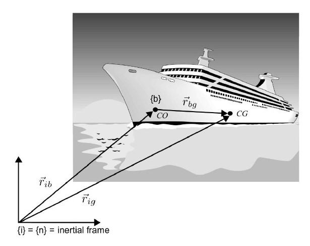

## Introduction

In our previous post on Kinematics, we built the mathematical bridge that connects a vehicle's body-frame velocities to its position and orientation in the world. We answered the question: "Given the vehicle's velocity, where is it going?" Now, we turn to the other half of the dynamics puzzle: **Kinetics**.

Kinetics is the study of the *forces and moments* that cause motion. It answers the fundamental question: "Given the forces acting on the vehicle, how will its velocity change?" This is the realm of Newton's second law $$F=ma$$ and its rotational equivalent.

However, applying these simple laws to a complex 6-DOF marine vehicle is not straightforward. The laws are defined in an idealized, non-accelerating inertial frame, but our vehicle operates in a rotating, **body-fixed frame.** This post will systematically walk through the process of translating these fundamental physical laws into a practical, complete 6-DOF rigid-body kinetic model, forming the core of any vehicle's **GNC system (Guidance, Navigation, and Control System).**

## 1. What is Kinetics?

The study of motion, **dynamics**, is elegantly split into two parts:

*   **Kinematics**: The *geometry of motion*, describing position and velocity without regard for forces. This was the focus of our last article.
*   **Kinetics**: The *cause of motion*, relating the forces and moments acting on a body to its resulting accelerations.

In short: $$dynamics = kinematics + kinetics$$. This article is dedicated to the latter. Our goal is to derive the famous rigid-body equation of motion:

$$M_{RB} \dot{\nu} + C_{RB}(\nu) \nu = \tau_{RB}$$

This equation describes how **the total external forces and moments**, $$\tau_{RB}$$, generate linear and angular accelerations, $$\dot{\nu}$$.

## 2. The Cast of Characters: Frames, Points, and Velocities

Before we dive into the laws of motion, let's re-establish our key reference frames and points, which are crucial for the derivation.

*   **North-East-Down (NED) Frame `{n}`**: Our local navigation frame, which we approximate as an **inertial frame**. This is a crucial assumption, as Newton's laws are only valid in a non-accelerating, non-rotating frame.
*   **BODY Frame `{b}`**: A frame fixed to the vehicle, with its origin at a convenient point, $$O_b$$. This frame rotates and translates with the vehicle, making it **non-inertial**.
*   **Coordinate Origin (CO)**: The origin $$O_b$$ of the BODY frame `{b}`. This is a fixed point on the vehicle, often its geometric center. It's the reference point for our final equations.
*   **Center of Gravity (CG)**: The point where the total gravitational force acts. Newton's laws are naturally formulated about this point. The position of the CG relative to the CO is given by the vector $$r_{bg}^b$$.

 

We use the standard SNAME notation for our state vectors:

*   **Generalized velocity in BODY `{b}`**: $$ \nu = [u, v, w, p, q, r]^T $$
*   **Generalized force in BODY `{b}`**: $$ \tau_{RB} = [X, Y, Z, K, M, N]^T $$

Our task is to find the matrices $$M_{RB}$$ **(Rigid-Body Mass)** and $$C_{RB}(\nu)$$ **(Rigid-Body Coriolis and Centripetal)** that govern the relationship between these vectors.

## 3. The Golden Standard: Newton-Euler Equations in an Inertial Frame

All of classical dynamics is built upon the Newton-Euler equations. These laws provide the "ground truth" for motion but are only valid under two strict conditions:

1.  They must be expressed in an **inertial frame** (our NED frame `{n}`).
2.  They must be formulated with respect to the body's **Center of Gravity (CG)**.

Let's state them formally.

*   **Newton's Second Law (Linear Motion):** The rate of change of linear momentum equals the sum of external forces.
    $$ \frac{d}{dt} (m v_{ig}) \bigg|_i = f_g $$
    where $$m$$ is the mass, $$v_{ig}$$ is the velocity of the CG in the inertial frame, and $$f_g$$ is the total force acting on the CG.

*   **Euler's Law (Angular Motion):** The rate of change of angular momentum about the CG equals the sum of external moments about the CG.
    $$ \frac{d}{dt} (h_g) \bigg|_i = m_g $$
    where $$h_g = I_g \omega_{ib}$$ is the angular momentum, $$I_g$$ is the inertia tensor about the CG, $$\omega_{ib}$$ is the angular velocity of the body in the inertial frame, and $$m_g$$ is the total moment about the CG.

These equations are physically pure but engineeringly impractical. We need to transform them into the rotating BODY frame `{b}` and reference them to the fixed CO.

## 4. The First Transformation: From Inertial {n} to Body {b} Frame

To move from the idealized inertial frame to the practical body frame, we need a mathematical tool that accounts for the rotation of the body frame.

### 4.1 The Crucial Tool: The Transport Theorem

The **Transport Theorem**, or the rule for differentiating a vector in a moving reference frame, is the cornerstone of this transformation. It states that the time derivative of any vector `a` in the inertial frame `{i}` is the sum of its derivative in the rotating body frame `{b}` and a "transport" term caused by the rotation of `{b}` itself.

$$ \frac{d}{dt}(a) \bigg|_i = \frac{d}{dt}(a) \bigg|_b + \omega_{ib} \times a $$

**Intuitive Explanation:** Imagine standing on a spinning merry-go-round `{b}` and extending your arm $$a$$. An observer on the ground (`{i}`) sees your arm's velocity $$\frac{d}{dt} (a) |_i$$
as a combination of two things: how fast you are moving your arm relative to the merry-go-round 
$$\frac{d}{dt} (a) |_b$$,
plus the velocity imparted to your arm simply by the merry-go-round's rotation $$\omega_{ib} \times a$$.

This theorem is our bridge between the two reference frames.

### 4.2 Transforming the Linear Motion Equation

Let's apply the Transport Theorem to Newton's Second Law. We start with the law in the inertial frame `{n}` (approximating `{i}`):

$$ f_g = \frac{d}{dt} (m v_{ng}) \bigg|_n = m \frac{d v_{ng}}{dt} \bigg|_n $$

Now, we use the theorem to express the inertial derivative 
$$\frac{d}{dt}|_n$$ 
in terms of the body-frame derivative 
$$\frac{d}{dt}|_b$$:

$$ f_g^b = m \left( \frac{d v_{ng}^b}{dt} \bigg|_b + \omega_{nb}^b \times v_{ng}^b \right) $$

Here, we've expressed all vectors in the BODY frame `{b}`. Using dot notation for the body-frame derivative 
$$\dot{v} = \frac{dv}{dt}|_b$$, we get:

$$ f_g^b = m (\dot{v}_{ng}^b + \omega_{nb}^b \times v_{ng}^b) $$

The term $$ m(\omega_{nb}^b \times v_{ng}^b) $$ is the **centripetal force** that appears because we are observing the motion from a rotating frame.

### 4.3 Transforming the Angular Motion Equation

We follow the exact same procedure for Euler's Law. We start in the inertial frame:

$$ m_g = \frac{d}{dt} (I_g \omega_{nb}) \bigg|_n $$

Applying the Transport Theorem:

$$ m_g^b = \frac{d}{dt} (I_g^b \omega_{nb}^b) \bigg|_b + \omega_{nb}^b \times (I_g^b \omega_{nb}^b) $$

Since the inertia tensor $$I_g^b$$ is constant in the BODY frame, the derivative only applies to $$\omega_{nb}^b$$:

$$ m_g^b = I_g^b \dot{\omega}_{nb}^b + \omega_{nb}^b \times (I_g^b \omega_{nb}^b) $$

The term $$ \omega_{nb}^b \times (I_g^b \omega_{nb}^b) $$ represents the **gyroscopic moments** that arise from describing rotational motion in a rotating frame.

#### Defining the Inertia Tensor $$I_g^b$$

The **inertia tensor** $$I_g^b$$ is a 3x3 symmetric matrix that describes how a rigid body's mass is distributed relative to the center of gravity (CG). It quantifies the body's resistance to angular acceleration. It is defined as:

$$
I_g^b = \begin{bmatrix}
I_x & -I_{xy} & -I_{xz} \\
-I_{yx} & I_y & -I_{yz} \\
-I_{zx} & -I_{zy} & I_z
\end{bmatrix}
$$

The matrix consists of two types of components:

1.  **Moments of Inertia (Diagonal Elements):** The terms $$I_x$$, $$I_y$$, and $$I_z$$ represent the resistance to angular acceleration about the principal body axes ($$x_b$$, $$y_b$$, and $$z_b$$, respectively). They are calculated by integrating the squared distance of each mass element from the axis of rotation:

    $$ I_x = \int_V (y^2 + z^2) \rho_m dV $$
    
    $$ I_y = \int_V (x^2 + z^2) \rho_m dV $$
    
    $$ I_z = \int_V (x^2 + y^2) \rho_m dV $$

2.  **Products of Inertia (Off-Diagonal Elements):** The terms $$I_{xy}$$, $$I_{xz}$$, and $$I_{yz}$$ represent the asymmetry of the mass distribution. A non-zero product of inertia (e.g., $$I_{xy}$$) implies that angular acceleration about one axis will induce a moment about another axis. For bodies with significant geometric symmetry, these terms are often zero or negligible. They are calculated as:

    $$ I_{xy} = I_{yx} = \int_V (xy) \rho_m dV $$
    
    $$ I_{xz} = I_{zx} = \int_V (xz) \rho_m dV $$
    
    $$ I_{yz} = I_{zy} = \int_V (yz) \rho_m dV $$

With this full definition of $$I_g^b$$, our transformed angular motion equation is now complete, providing a precise relationship between applied moments and resulting angular accelerations in the body frame.

### 4.4 Assembled Equations about CG (in Body Frame)

We can now combine the transformed linear and angular equations into a single 6-DOF matrix equation. This equation is still about the **Center of Gravity (CG)**, but is now expressed entirely in the BODY frame `{b}`.

$$
\begin{bmatrix} m I_{3\times3} & 0_{3\times3} \\ 0_{3\times3} & I_g^b \end{bmatrix}
\begin{bmatrix} \dot{v}_{ng}^b \\ \dot{\omega}_{nb}^b \end{bmatrix} +
\begin{bmatrix} m S(\omega_{nb}^b) & 0_{3\times3}\\ 0_{3\times3} & -S(I_g^b \omega_{nb}^b) \end{bmatrix}
\begin{bmatrix} v_{ng}^b \\ \omega_{nb}^b \end{bmatrix} =
\begin{bmatrix} f_g^b \\ m_g^b \end{bmatrix}
$$

Note: we used the skew-symmetric matrix $$S(\cdot)$$ to represent the cross product, e.g., $$a \times b = S(a)b$$.

This is a major step forward! The matrices represent the mass ($$M_{RB}^{CG}$$) and Coriolis ($$C_{RB}^{CG}$$) terms for a system described about its CG. Notice the block-diagonal structure; at the CG, linear and angular dynamics are decoupled in the mass matrix.

## 5. The Second Transformation: From CG to an Arbitrary CO

While the CG-based equation is clean, it's not practical for two main reasons:

1.  The **CG can move** as a vehicle consumes fuel or deploys a payload. Constantly updating the model for a shifting CG is cumbersome.
2.  Our **control objectives** are usually defined relative to a fixed point on the vehicle body (like the geometric center or a sensor location), not the CG.

Therefore, we must perform a final transformation to express the equations of motion about a fixed **Coordinate Origin (CO)**.

### 5.1 Relating Velocities: The H-Matrix

First, we need to relate the velocities of the CG and the CO. The velocity of the CG ($$v_{ng}$$) is the velocity of the CO ($$v_{nb}$$) plus the velocity of the CG relative to the CO due to the body's rotation.

$$ v_{ng}^b = v_{nb}^b + \omega_{nb}^b \times r_{bg}^b $$

where $$r_{bg}^b$$ is the vector from the CO to the CG.

This relationship, along with the fact that angular velocity is the same for the whole rigid body ($$\omega_{ng}^b = \omega_{nb}^b$$), can be written compactly using a transformation matrix, often called the **H-matrix**:

$$
\begin{bmatrix} v_{ng}^b \\ \omega_{nb}^b \end{bmatrix} =
\begin{bmatrix} I_{3\times3} & -S(r_{bg}^b) \\ 0_{3\times3} & I_{3\times3} \end{bmatrix}
\begin{bmatrix} v_{nb}^b \\ \omega_{nb}^b \end{bmatrix}
\quad \implies \quad
\nu_g = H(r_{bg}^b) \nu_b
$$

This matrix provides a powerful tool for shifting the reference point of our dynamic equations.

### 5.2 Transforming the Full Kinetic Equation

The transformation of the full dynamic system from CG to CO is achieved by applying the H-matrix. Starting with our CG-based equation:

$$ M_{RB}^{CG} \dot{\nu}_g + C_{RB}^{CG}(\nu_g) \nu_g = \tau_g $$

By substituting $$\nu_g = H(r_{bg}^b) \nu_b$$ and applying some algebraic manipulation (pre-multiplying by $$H^{T}(r_{bg}^b)$$), we arrive at the final form expressed about the CO:

$$ (H^{T}(r_{bg}^b) M_{RB}^{CG} H(r_{bg}^b)) \dot{\nu}_b + (H^{T}(r_{bg}^b) C_{RB}^{CG} H(r_{bg}^b)) \nu_b = H^{T}(r_{bg}^b) \tau_g $$

This gives us the final mass and Coriolis matrices about the CO:

$$ M_{RB} = H^{T}(r_{bg}^b) M_{RB}^{CG} H(r_{bg}^b) $$

$$ C_{RB}(\nu_b) = H^{T}(r_{bg}^b) C_{RB}^{CG} H(r_{bg}^b) $$

### 5.3 The Power of the Parallel-Axis Theorem

Let's expand the new mass matrix $$M_{RB}$$. Performing the matrix multiplication yields:

$$
M_{RB} = \begin{bmatrix} m I_{3\times3} & -m S(r_{bg}^b) \\ m S(r_{bg}^b) & I_g^b - m S^2(r_{bg}^b) \end{bmatrix}
$$

The bottom-right block, $$I_g^b - m S^2(r_{bg}^b)$$, is of special interest. This is precisely the mathematical expression for the **Huygens-Steiner Parallel-Axis Theorem**, which transforms the inertia tensor from being about the CG to being about the new origin, CO. We can define this as the inertia tensor about the CO:

$$ I_b = I_g^b - m S^2(r_{bg}^b) $$

This theorem is not a separate step but rather emerges naturally from the coordinate transformation, elegantly linking the geometry of the mass distribution to the dynamics.

## 6. The Grand Finale: The 6-DOF Rigid-Body Equations of Motion

We have arrived at our final destination. The complete 6-DOF rigid-body equations of motion, expressed in the BODY frame `{b}` and about the Coordinate Origin (CO), are:

$$M_{RB} \dot{\nu} + C_{RB}(\nu) \nu = \tau_{RB}$$

where:

*   The **Rigid-Body Mass Matrix** $$M_{RB}$$ is constant, symmetric, and positive-definite:
  
    $$
    M_{RB} = \begin{bmatrix} m I_{3\times3} & -m S(r_{bg}^b) \\ m S(r_{bg}^b) & I_b \end{bmatrix}
    $$

*   The **Rigid-Body Coriolis and Centripetal Matrix** $$C_{RB}(\nu)$$ is linear in velocity and has a special property known as **skew-symmetry** ($$C_{RB} = -C_{RB}^T$$):
  
    $$
    C_{RB}(\nu) = \begin{bmatrix} 0_{3\times3} & -m S(v_1) - m S(S(v_2)r_{bg}^b) \\ -m S(v_1) - m S(S(v_2)r_{bg}^b) & -S(I_b v_2) \end{bmatrix}
    $$
    
    (where $$\nu = [v_1^T, v_2^T]^T$$). The skew-symmetry property is vital in control theory, as it implies that the Coriolis and centripetal forces do no work on the system ($$\nu^T C_{RB} \nu = 0$$), a key element in proving the stability of many nonlinear control laws.

## Conclusion

This post has traced the path from the fundamental laws of Newton and Euler to the comprehensive 6-DOF rigid-body equations of motion used in modern marine vehicle GNC. The journey involved two critical transformations:

1.  **From Inertial to Body Frame:** Using the Transport Theorem, which introduced the Coriolis and centripetal terms.
2.  **From Center of Gravity to Coordinate Origin:** Using the H-matrix transformation, which naturally incorporated the Parallel-Axis Theorem.

The resulting equation, $$M_{RB} \dot{\nu} + C_{RB}(\nu) \nu = \tau_{RB}$$, provides the core model describing how a rigid body's inertia resists changes in motion. This is the bedrock of vehicle dynamics. However, our work is not done. The term on the right, $$\tau_{RB}$$, represents the *total* of all external forces and moments. The next logical step, and the topic of a future post, is to model these forces—including hydrostatics (buoyancy), hydrodynamics (lift and drag), propulsion, and environmental disturbances—to complete our vehicle's dynamic model.

## References

[1] T. I. Fossen, *Handbook of Marine Craft Hydrodynamics and Motion Control*. Hoboken, NJ, USA: John Wiley & Sons, 2011.

[2] *Nomenclature for Treating the Motion of a Submerged Body Through a Fluid*. The Society of Naval Architects and Marine Engineers (SNAME), Technical and Research Bulletin No. 1-5, April 1950.

